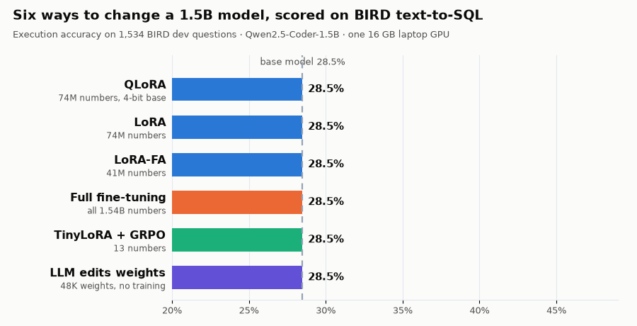

# text2sql-peft

**Six ways to change a language model, compared on one task with one model.**

[](https://shra012.github.io/Portfolio/#/blog)
[](#results)


<p align="center">
  
</p>

A small coding model, [Qwen2.5-Coder-1.5B-Instruct](https://huggingface.co/Qwen/Qwen2.5-Coder-1.5B-Instruct), is
fine-tuned for text-to-SQL with full fine-tuning, LoRA, LoRA-FA, QLoRA and TinyLoRA (with SFT and with GRPO), then
edited directly by an LLM with no training at all ("weight-space programming"). Every variant is scored the same way
on the [BIRD](https://bird-bench.github.io/) dev set by running its SQL against the real databases.

## 📖 Read the blog

The full story, written for readers new to fine-tuning, is a three-part series on
**[my blog](https://shra012.github.io/Portfolio/#/blog)**:

| Part | What it covers |
|---|---|
| [**1. Fine-tuning explained: 6 ways to teach an AI model**](https://shra012.github.io/Portfolio/#/blog/finetuning_series_1_methods) | Weights, loss and gradients from scratch; each method with a toy example, a diagram and short code; SFT vs RL and GRPO |
| [**2. How I tested them: teaching AI to write SQL**](https://shra012.github.io/Portfolio/#/blog/finetuning_series_2_how) | Prompts, the sandboxed SQL grader, identical training rules, and fitting it all on 16 GB |
| [**3. The results: which fine-tuning method won?**](https://shra012.github.io/Portfolio/#/blog/finetuning_series_3_results) | Scores, significance tests, real before/after SQL, costs, and what weight-space programming found |

## Results

BIRD dev, 1,534 questions, execution accuracy (EX): the model's SQL must return the same rows as the gold SQL.

| Method | Trained / changed | EX | Simple | Moderate | Challenging | Train time | Peak VRAM |
|---|---:|---:|---:|---:|---:|---:|---:|
| Base model | 0 | 28.49 | 35.78 | 17.89 | 15.86 | – | – |
| Full fine-tuning | 1.54B | 36.11 | 42.38 | 28.88 | 19.31 | 25 min | 7.6 GB |
| LoRA (r=64) | 73.9M | 42.05 | 49.62 | 32.33 | 24.83 | 31 min | 5.0 GB |
| LoRA-FA | 41.3M | 40.55 | 48.43 | 30.39 | 22.76 | 31 min | 4.6 GB |
| **QLoRA (NF4)** | 73.9M | **42.44** | 49.41 | 32.97 | 28.28 | 41 min | 4.0 GB |
| QLoRA, served in 4-bit | 73.9M | 41.46 | 48.54 | 32.11 | 26.21 | – | – |
| TinyLoRA + SFT | 13 | 30.44 | 36.97 | 21.12 | 18.62 | 30 min | 3.7 GB |
| TinyLoRA + GRPO | 13 | 30.44 | 37.51 | 20.26 | 17.93 | 128 min | 11.1 GB |
| Weight-space programming (Claude Opus 5.5) | 48,398 changed | 30.12 | 37.41 | 19.83 | 16.55 | no training | – |

What it shows:

- **LoRA and QLoRA win** (+14 points, McNemar p < 1e-26). Most of the gain is the model learning which column lives in
  which table: "no such column" errors drop from 602 to about 300.
- **Full fine-tuning lags** under a 16 GB budget: bf16 weights without a 32-bit master copy swallow tiny updates, and
  92% of the weights never changed.
- **TinyLoRA's 13 numbers and weight-space programming both fix answer format, not knowledge.** Both remove the model's habit
  of explaining before answering (every answer now starts with SQL) and gain about 2 points, which is not significant.
  SFT matched GRPO for TinyLoRA.
- **Weight-space edits fix exactly the habit they target.** A broad search (84 passes, 44 candidates) found nothing that survived
  re-testing: the screening winners were luck (the winner's curse). A pre-registered round (`wsp/protocol/`) then
  confirmed one real fix, quoting table names like `Store Locations` (+18 net on 1,024 held-out practice questions,
  p = 0.002), but BIRD dev barely contains that mistake, so dev stayed at 30.05%.

Setup: 2,000 BIRD-train questions per SFT method (same subset, order and 125 steps), one seed each, greedy decoding,
RTX 3080 Ti (16 GB) under WSL2. The whole training pipeline runs unattended in about 6 hours.

## Repository layout

```
configs/            one YAML per training method
src/t2s/
  prompt.py         schema + example values + evidence -> chat prompt; SQL extraction
  bird_eval.py      execution accuracy, sandboxed (read-only, SQLite authorizer, timeouts, row cap)
  data.py           BIRD json -> data/processed/*.jsonl
  methods.py        build the model for full / lora / lora_fa / qlora / tinylora
  tinylora.py       TinyLoRA (arXiv:2602.04118): SVD bases, random projections, one shared vector
  train_sft.py      supervised fine-tuning, loss on the SQL only
  train_grpo.py     GRPO for TinyLoRA with an execution reward (TRL + colocated vLLM)
  merge.py          adapters -> plain checkpoints
  evaluate.py       vLLM greedy decoding on BIRD dev -> results/<run>/
  report.py         results/summary.md and figures
  wsp/              weight-space programming harness: CPU weight kernel, budgeted forward-pass tool, save_edit
scripts/scheduler.py  runs the whole experiment: sweeps, training, merging, evaluation, report
results/            predictions and metrics for every run
wsp/notebook/       the LLM editors' lab notebooks and analysis scripts
blog/               blog sources: series HTML, SVG charts and the tools that build them
tests/
```

## Reproduce

Requires a CUDA GPU with 16 GB, [uv](https://docs.astral.sh/uv/) and about 80 GB of disk.

```bash
uv sync

# BIRD data (train is 8.9 GB)
mkdir -p data/raw && cd data/raw
curl -LO https://bird-bench.oss-cn-beijing.aliyuncs.com/dev.zip
curl -LO https://bird-bench.oss-cn-beijing.aliyuncs.com/train.zip
cd ../..   # extract into data/bird/dev and data/bird/train (including the nested *_databases.zip)

.venv/bin/python -m t2s.data                       # build prompts -> data/processed/
.venv/bin/python -m t2s.evaluate --model Qwen/Qwen2.5-Coder-1.5B-Instruct --name base
.venv/bin/python scripts/scheduler.py              # every method end to end, then results/summary.md
```

Single steps:

```bash
.venv/bin/python -m t2s.train_sft --config configs/lora.yaml --out runs/lora
.venv/bin/python -m t2s.merge --run runs/lora --out checkpoints/lora
.venv/bin/python -m t2s.evaluate --model checkpoints/lora --name lora
```

### Weight-space programming

Replicates the setup of MIT CSAIL's
[Sparks of Weight-Space Programming](https://rikiyat.github.io/blog/weight-space-programming/): an LLM may read the
weights on CPU, run the model only through a budgeted tool, and submit edits; no gradients or training.

```bash
.venv/bin/python -m t2s.wsp.tool prepare             # practice set from BIRD train
.venv/bin/python -m t2s.wsp.tool gen --which both --sample 256   # costs one pass
.venv/bin/python -m t2s.wsp.tool status
```

Three rounds, all notebooks in `wsp/notebook/`:

| Round | Passes | Outcome | Rebuild |
|---|---:|---|---|
| 1 | 19 | F4: removes the "Let's walk through…" opener (rank-one patch, 32 columns of layer 27's MLP output); dev 30.12% | `wsp/notebook/edit_f4.py` |
| 2 | 65 | 44 candidates screened, none survived re-testing | `wsp/notebook/relaxed_20261107/` |
| 3 | 4 | Pre-registered protocol (`wsp/protocol/`): Q1 = F4 + quoting fix, p = 0.002 on held-out practice; dev 30.05% | `wsp/notebook/strict_20261108/edit_q1.py` |

## Tests

```bash
.venv/bin/python -m pytest tests          # or: .venv/bin/python -m unittest discover tests
.venv/bin/ruff check src scripts blog/tools tests
```

## References

- Hu et al., [LoRA](https://arxiv.org/abs/2106.09685) · Zhang et al., [LoRA-FA](https://arxiv.org/abs/2308.03303) ·
  Dettmers et al., [QLoRA](https://arxiv.org/abs/2305.14314)
- Morris et al., [Learning to Reason in 13 Parameters](https://arxiv.org/abs/2602.04118) (TinyLoRA)
- Shao et al., [DeepSeekMath](https://arxiv.org/abs/2402.03300) (GRPO)
- Takehi, Teoh, Zhang and Khattab, [Sparks of Weight-Space Programming](https://rikiyat.github.io/blog/weight-space-programming/)
- Li et al., [BIRD](https://bird-bench.github.io/)
